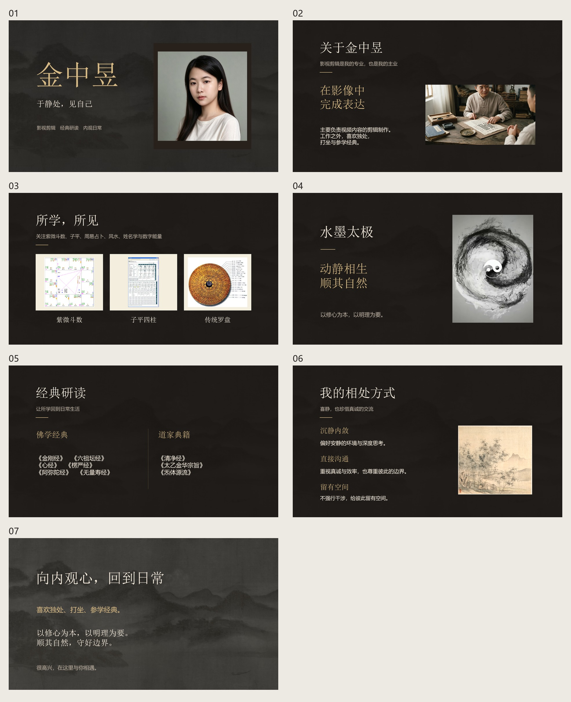

# 金中昱个人介绍 · 第一版「暖黑鎏金」

基于最新版个人网站制作，16:9 横版，共 7 页。文字与图片为独立可编辑对象，人物保留原始色彩。

[下载 PPTX](金中昱个人介绍_暖黑鎏金.pptx?raw=true)

下载后使用 PowerPoint 或 WPS 打开。GitHub 不直接播放 PPTX。

## 全 7 页预览

内容依次为：人物封面、个人与工作、传统文化素材、水墨太极、经典研读、相处方式、生活态度。

本版为静态演示稿，太极使用视频截帧，未嵌入网页鼠标交互与视频播放。字体采用宋体与微软雅黑，素材来源记录在各页备注中。
