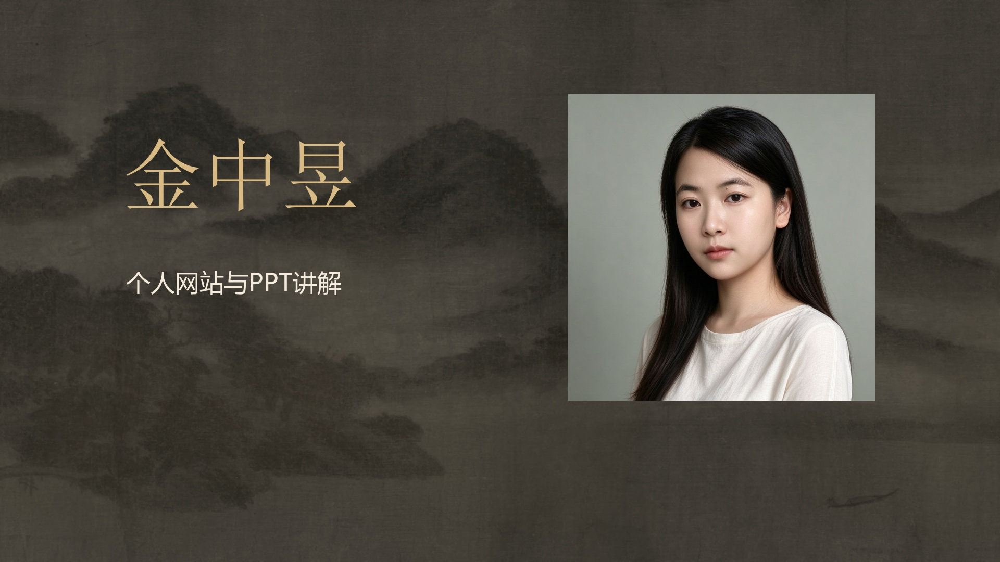

# 金中昱 · 个人网站与 PPT 讲解视频

基于最新版流动山水背景个人网站与第一版「暖黑鎏金」7 页 PPT 制作。约 2 分钟，含普通话 AI 女声、中文字幕、配乐、原始水墨太极影像与网页交互示意。

## 下载

- [下载 MP4 成片](金中昱_个人网站与PPT讲解_1080p.mp4?raw=true)
- [下载完整包：视频、封面、字幕、讲解稿及素材来源](金中昱_网站与PPT讲解视频.zip?raw=true)
- [下载字幕 SRT](subtitles.srt?raw=true)
- [查看逐镜预览](storyboard.jpg)

下载后可使用电脑或手机的视频播放器观看。

## 内容与规格

影片依次讲解网站主线、首页人物与姓名、全站山水背景、鼠标及滚动联动、太极与个人文字、7 页演示稿，以及 GitHub 文件下载和编辑方式。

1920×1080，16:9 横版，60fps，120.5 秒。H.264 画面，AAC 48kHz 立体声。MP4 已包含画面字幕，另附可独立使用的 SRT。

人物照片采用原始素材并保留原色。旁白为本地普通话 AI 女声 Microsoft Yaoyao，未使用本人音色克隆。采用横版文字四边各留 10% 的制作安全区，未另加四角角标。

## 制作与素材来源

- 使用 [Vibe 知识大赏](https://github.com/andyhuo520/vibe-knowledge) 的脚本、分镜与质检流程，适配为 Windows 下的 FFmpeg 代码渲染。
- 背景音乐为该工具随附的 `vibe-bgm`。作者 NOTICE 允许用于该工具制作的视频，音乐原文件未单独分发。
- 按键音效：[unicaegames, Keyboard Sounds](https://opengameart.org/content/keyboard-sounds)，CC0。
- 国画山水：[Cleveland Museum of Art, Cloudy Mountains, 1933.220](https://www.clevelandart.org/art/1933.220)，CC0。
- 其他内容与素材来源记录在完整包及原 PPT 各页备注中。

本目录保存讲解视频，网站与 PPT 文件仍可通过仓库首页找到。
